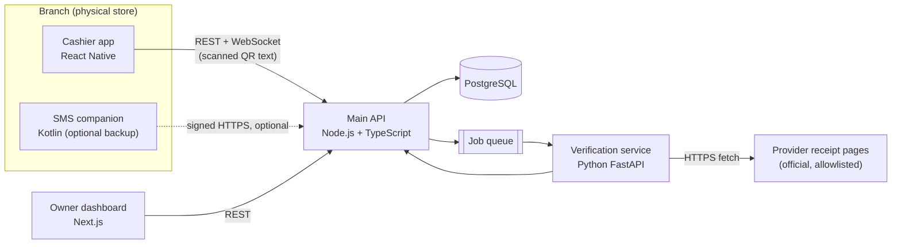
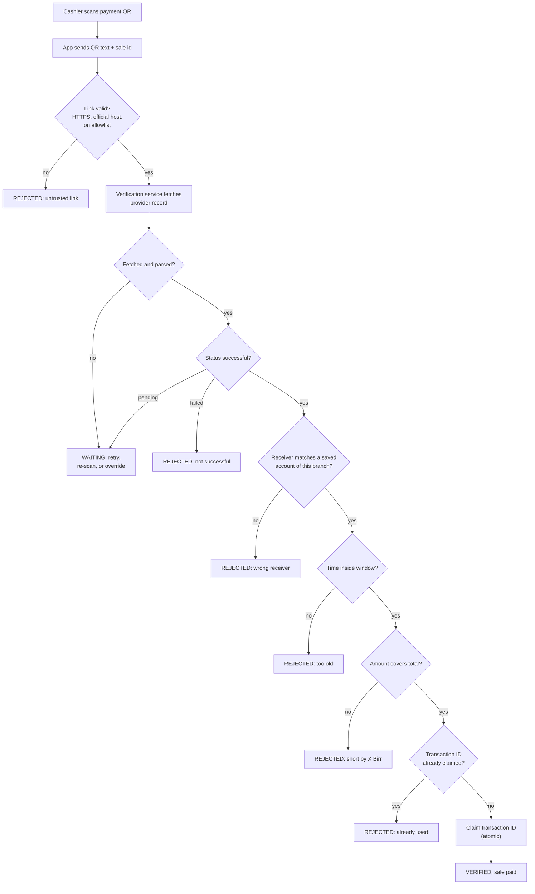

# 02 · Technical Requirements Document

| | |
|---|---|
| **Version** | 0.1 draft, 24 Oct 2026 |
| **Related** | [PRD](01-product-requirements.md) · [Schema](05-backend-schema.md) · [Guardrails](agent/GUARDRAILS.md) |

---

## 1. Architecture at a glance



| Component | Responsibility | Language |
|---|---|---|
| **Cashier app** | Scan items and payment QR, cart, sale flow, offline outbox | TypeScript (React Native) |
| **Owner dashboard** | Branch, cashier, product, and payment account management, reports, alerts | TypeScript (Next.js) |
| **Main API** | Auth, roles, catalog, sales, receiver matching, verdict decisions, claims, reporting | TypeScript (Node.js) |
| **Verification service** | The only component that fetches provider pages. Validates the link, fetches safely, parses the record, returns evidence | Python (FastAPI) |
| **PostgreSQL** | System of record | SQL |
| **SMS companion** *(optional)* | Backup evidence: read provider SMS, parse, sign, upload | Kotlin |
| **Mock provider server** *(dev and test only)* | Imitates provider receipt pages so verification can be built and tested without real payments | Python or Node |

**Design principle:** the Main API owns every decision that touches money. The verification service fetches and parses the provider record and returns *evidence*. It cannot mark a sale as paid.

## 2. Technology choices

| Layer | Choice | Reason |
|---|---|---|
| Mobile | React Native + TypeScript, Android first | Reuses existing React skills, iOS stays possible |
| Camera and scanning | `react-native-vision-camera` with a code-scanner plugin | Fast barcode and QR scanning on mid-range phones |
| Local storage (device) | SQLite | Catalog cache and sales outbox for offline use |
| Web | Next.js built as a **static export**, TypeScript, Tailwind, Recharts | Dashboards and charts quickly, served as static files from a CDN, with data fetched from the API |
| API | Node.js, TypeScript, NestJS or Express with Zod validation | One language across mobile, web, and API |
| Verification | Python, FastAPI, httpx, an HTML parser (selectolax or BeautifulSoup), QR decoding. OCR and image libraries only if the optional image checks are built | One isolated service for all outbound fetching and parsing |
| Database | PostgreSQL 16 or newer | Transactions, strict constraints, solid reporting queries |
| Queue | BullMQ on Redis, or Postgres-based queue if Redis is too heavy | Verification jobs with retries |
| Object storage | Local disk for dev, S3-compatible for deployment | Any kept images or page copies |
| Auth | JWT access tokens, rotating refresh tokens, Argon2id password hashing | Standard and well understood |
| Realtime | WebSocket, with polling fallback | Live "payment arrived" updates |
| Packaging | pnpm workspaces monorepo, Docker Compose | One repo, reproducible demo |

Exact versions are pinned in Milestone 1 and recorded in [TOOLS.md](agent/TOOLS.md).

## 3. Repository layout (target)

```
payproof/
├── apps/
│   ├── cashier-app/        React Native
│   ├── owner-web/          Next.js
│   ├── sms-companion/      Kotlin (Android), optional backup
│   └── api/                Node.js API
├── services/
│   ├── verification/       Python FastAPI
│   └── mock-provider/      Fake provider receipt pages for dev and tests
├── packages/
│   ├── shared-types/       Zod schemas and TS types shared by all TS apps
│   ├── money/              Integer money helpers
│   └── ui-tokens/          Design tokens from DESIGN.md
├── db/
│   ├── migrations/
│   └── seed/
├── evals/                  Datasets (synthetic only in git) and harness
├── docs/
└── docker-compose.yml
```

## 4. Payment verification pipeline

### 4.1 Principle

> **The provider's own record is the truth, and our server fetches it.**
> A sale is verified only when the provider's receipt page, fetched by us from an allowlisted address, shows a successful payment to one of the branch's saved accounts for at least the cart total, and the transaction ID has never been claimed. Nothing shown on the customer's phone, and no image, is proof by itself.

This rests on **Assumption A1** (the payment QR links to a readable provider page). If A1 is false, see section 4.8.

### 4.2 Steps



### 4.3 Evidence stored per verification

| Field | Source |
|---|---|
| Provider, transaction ID | Provider record |
| Amount, currency, payment time, status | Provider record |
| Receiver name and masked account | Provider record |
| Payer name (masked) | Provider record |
| Link host and path pattern | Scanned QR (query values redacted) |
| Fetch time, HTTP status, parser version | Our service |
| Match results: receiver, amount, time | Main API |
| Verdict and reasons | Main API |

The full page is not kept. Only the fields above are stored. If a short-lived copy is needed for debugging, it expires after the retention period.

### 4.4 Decision rules (Main API)

Rules run in this order. The first that applies decides.

| # | Condition | Verdict |
|---|---|---|
| 1 | Link is not HTTPS, host is not on the allowlist, or it redirects off the allowlist | **Rejected: untrusted link** |
| 2 | Page could not be fetched or parsed (timeout, error, layout changed) | **Waiting**, then owner override if it keeps failing |
| 3 | Provider status is pending | **Waiting** |
| 4 | Provider status is failed or reversed | **Rejected: not successful** |
| 5 | Receiver does not match a saved account of this branch | **Rejected: wrong receiver** |
| 6 | Payment time is outside the allowed window | **Rejected: too old** (owner may override) |
| 7 | Amount is less than the total | **Rejected: short**, with the shortfall |
| 8 | Transaction ID already claimed | **Rejected: already used** |
| 9 | All checks pass | **Verified**, claim recorded atomically |

An overpayment is accepted and the difference recorded on the sale.

### 4.5 Receiver matching

Each branch has one or more **saved payment accounts**: provider, account holder name, and account or phone number, entered by the owner.

- Match on the strongest identifier the provider page shows: the account or phone number if shown (full or partially masked), otherwise the normalized account holder name.
- If the page shows more than one identifier, **all** of them must agree.
- Names are normalized before comparison (case, spacing, punctuation, common transliteration differences). A near-match is not a match. It is shown to the owner as a warning, not accepted.
- Exact rules per provider live in a configuration table, because each provider shows different details.

### 4.6 Safe fetching (SSRF and lookalike links)

The customer controls the QR content, so the server must treat it as hostile input.

| Control | Detail |
|---|---|
| Host allowlist | Only official provider hostnames, held in configuration |
| HTTPS only | Certificate validation on, no downgrades |
| Redirects | Followed only if every hop stays on the allowlist, limited in count |
| Network isolation | The verification service runs with outbound access limited to the allowlist where possible, and refuses private, loopback, and link-local addresses |
| Limits | Short timeouts, response size cap, content type check, no cookies or credentials sent |
| No script execution | The page is parsed as data, never rendered with a full browser unless M0 proves it is required, and then only in a sandbox |
| Rate control | Per-device and per-provider limits, with caching of results for the same transaction |

### 4.7 When the QR cannot be used

| Situation | What happens |
|---|---|
| QR unreadable (glare, crack) | Cashier re-scans, or asks the customer to open the receipt again |
| No QR on the receipt | Cashier enters the payment ID if the provider supports lookup by ID (to be confirmed in M0). Otherwise owner override |
| Provider page down | Waiting, automatic retries, then cashier chooses retry or owner override |
| Cashier phone offline | The scanned QR text is queued. The sale stays "Payment not verified yet" and verifies on reconnection |

### 4.8 If Assumption A1 is false

Milestone 0 tests A1 first. If the QR does not lead to a readable provider page:

1. Receiver, amount, and transaction ID come from the receipt image by OCR.
2. Proof that money arrived comes from the SMS companion matching the branch's payment SMS.
3. Image edit detection becomes a supporting risk signal.
4. The SMS companion and the OCR service become required, and the plan inserts them before the cashier payment UX milestone.

The docs keep that design as a documented fallback so the project is not stranded by one unknown.

### 4.9 Backup evidence (optional)

If built, SMS events and receipt-image checks can add warnings and alerts, and can corroborate a verification, for example when a provider page is slow. They are advisory: **they never verify a sale on their own.**

## 5. SMS companion design (optional backup)

Built only after the core QR flow works. Its job is corroboration and an extra fraud signal, not the main check.

- Foreground service with a registered broadcast receiver for incoming SMS.
- Filters by known provider sender ID, parses with provider rules, and discards everything else without storing it.
- Uploads `{provider, txnId, amount, eventTime, counterpartyMasked, rawHash, parseConfidence}` over HTTPS.
- Each upload is signed with HMAC using a per-device secret issued at pairing.
- Local outbox with exponential backoff. The server treats duplicate uploads as no-ops.
- Pairing uses a one-time code generated in the dashboard.
- Raw SMS text is not stored on the server, only a hash and parsed fields.

## 6. Offline and sync

| Concern | Rule |
|---|---|
| Catalog | Pulled to SQLite on login and kept fresh by incremental sync. Server wins on conflicts. |
| Sales | Created on the device with a client-generated UUID v7 and an idempotency key. Sales are append-only, so there are no merge conflicts. |
| Cash sales offline | Completed locally, uploaded later. |
| Mobile-money offline | The scanned QR text is saved with the sale as `payment_pending`. It is verified when the phone is online. The cashier sees a clear "Payment not verified yet" state, and the owner's policy decides whether goods may be released. |
| Upload retries | Exponential backoff. The server upserts by idempotency key. |
| Clock drift | Device time is stored as `client_created_at`. The server time is authoritative for reports. |

## 7. API design

REST over HTTPS, JSON, versioned under `/v1`. OpenAPI is generated from Zod schemas.

**Conventions**
- Errors use one shape: `{ "error": { "code": "PAYMENT_ALREADY_CLAIMED", "message": "<safe, human text>", "ref": "7F3K" } }`. No stack traces, SQL, or internal names ever appear in `message`. `ref` is searchable in server logs
- Pagination by cursor. Timestamps in ISO 8601 UTC. Money as integer santim.
- Every write accepts an `Idempotency-Key` header.

**Main endpoints (initial)**

| Area | Endpoint |
|---|---|
| Auth | `POST /v1/auth/register-owner`, `login`, `refresh`, `logout`, `pin/verify` |
| Branches | `GET/POST /v1/branches`, `PATCH /v1/branches/:id` |
| Cashiers | `GET/POST /v1/cashiers`, `PATCH /v1/cashiers/:id`, `DELETE /v1/cashiers/:id` |
| Products | `GET/POST /v1/products`, `PATCH/DELETE /v1/products/:id`, `POST /v1/products/import` |
| Catalog sync | `GET /v1/sync/catalog?since=` |
| Sales | `POST /v1/sales`, `GET /v1/sales/:id`, `POST /v1/sales/:id/void` |
| Payment accounts | `GET/POST /v1/branches/:id/payment-accounts`, `PATCH/DELETE /v1/branches/:id/payment-accounts/:accountId` |
| Verification | `POST /v1/sales/:id/payment/verify` (body: scanned QR text or payment ID), `POST /v1/sales/:id/payment/override`, `GET /v1/sales/:id/payment` |
| Backup evidence (optional) | `GET /v1/branches/:id/payment-inbox`, `POST /v1/devices/pair`, `POST /v1/sms-events` |
| Reports | `GET /v1/reports/summary`, `.../by-branch`, `.../by-product`, `.../by-cashier`, `.../export.csv` |
| Alerts | `GET /v1/alerts`, `PATCH /v1/alerts/:id` |
| Realtime | `WS /v1/ws` with channels per branch and per sale |

Authoritative contracts will be generated into `packages/shared-types`.

## 8. Security requirements

| Area | Requirement |
|---|---|
| Authentication | Short-lived access tokens, rotating refresh tokens, Argon2id hashing, login rate limits, lockout after repeated failures |
| Authorization | Role and branch checks on every endpoint, enforced in one shared layer, with automated tests that try to cross business and branch boundaries |
| Secrets | None in the apps or web bundle. Server-side environment or secrets manager only. Secret scanning on the repo, the web bundle, and the APK. See [SECURITY.md](../SECURITY.md) |
| Data separation | Every table is keyed by business, and every query is scoped. **Row-level security is enabled and forced on every table with written policies** (see [schema section 6](05-backend-schema.md)) |
| Input validation | Zod on every endpoint, uploads checked by content, QR text parsed against an allowlist, AI and tool output treated as untrusted |
| Rate limiting | **Every** endpoint, keyed by user, device, and IP, shared across instances. Starting limits in [SECURITY.md](../SECURITY.md#8-s6-rate-limiting-on-every-api) |
| Error handling | Users never see backend errors. The API returns a stable code, a safe message, and a reference ID. Details stay in server logs |
| Transport | TLS everywhere. SMS uploads are HMAC-signed with replay protection (timestamp and nonce) |
| Storage | Any kept images or page copies in private storage with signed, short-lived URLs |
| Secrets | Environment variables only, never in git |
| Inputs | Zod validation at every boundary, file type and size limits on uploads, images re-encoded before analysis |
| Outbound fetching | Only the verification service fetches external pages, and only allowlisted provider hosts. See section 4.6 |
| Saved payment accounts | Account numbers encrypted at rest and shown masked in the UI. Changes need the owner's PIN and are audit-logged |
| Logging | No passwords, tokens, or full payment details in logs |
| Dependencies | Lockfiles, audit in CI |

## 9. Performance targets

| Operation | Target |
|---|---|
| Barcode scan to cart line | < 300 ms on device |
| Catalog of 5,000 products on device | Searchable in < 100 ms |
| QR text to server (a short string) | < 500 ms on a typical mobile connection |
| Verification, QR scan to verdict, online | p95 < 5 s, including the provider page fetch |
| Dashboard summary for one month, 3 branches | < 1.5 s |

### Speed rules (build rules)

These are rules for how things are built, not only targets. A change that breaks one needs a reason.

| Rule | What it means here |
|---|---|
| **No uncompressed JSON** | Brotli or gzip on every response over about 1 KB, at the edge or the API. Request bodies from the app (such as batched offline sales) are gzipped. Payloads are lean: only the fields the screen needs, cursor pagination, no repeated nested objects, IDs instead of whole objects, delta sync for the catalog |
| **Sensible database writes** | One transaction per sale (sale, items, claim). Batch inserts with multi-row `INSERT` or `unnest` for sync and CSV import. No writes inside loops. Idempotent upserts for sync. Update only changed columns. No write on a read path, or throttle it (for example `last_seen_at`). Totals are computed from views, not updated on every sale. Index only what a real query needs |
| **No single dependency bottleneck** | A provider page being slow or down must not stop the shop. Cash sales never depend on the provider. Mobile-money sales go to Waiting, retry, and can use an owner override. Per-provider timeouts and a circuit breaker, queued retries, cached results for a transaction. API and verification service are stateless and can run as several copies. If Redis is not available the queue can fall back to Postgres. A failing dashboard widget shows its own error and does not block the others |
| **Optimistic rendering** | Taps respond instantly. A scan adds the line immediately. Cash sales complete on the device and sync later. Lists update before the server confirms and roll back with a clear message if it fails. **Exception: money verdicts.** The app may show the verdict screen shell instantly with a skeleton, but never shows Verified until the server decides |
| **Statically hosted web** | The owner dashboard is a static build on a CDN or static host. No server-side rendering and no web server runtime. Hashed assets with long cache lifetimes, and the HTML shell cached briefly. Data comes from the API after load. The API and verification service are the only server parts |
| **Skeletons, not spinners** | Where the layout is known, show a skeleton that matches it. See [DESIGN.md](../DESIGN.md) |

## 10. Testing strategy

| Level | Tools | Focus |
|---|---|---|
| Unit | Vitest, pytest | Money math, parsers, decision rules |
| Integration | API tests against a real Postgres in Docker | Constraints, claims, scoping, idempotency |
| Contract | Generated OpenAPI checks | Mobile and web match the API |
| Verification evals | Custom harness and a mock provider server | Parsing accuracy and decision correctness, see [EVALS.md](agent/EVALS.md) |
| E2E | Maestro for mobile, Playwright for web | Core flows |
| Security | RLS policy matrix, authorization matrix, rate-limit tests, secret scan of repo, web bundle and APK, input fuzzing, error-leak tests, dependency audit | Cross-branch access, replay, leaks |
| Usability | Task tests with 5+ people | Cashier speed and errors |

## 11. Deployment

- Local and demo: `docker compose up` brings up Postgres, Redis, API, and verification service. The web dashboard is built to static files and served by a simple static server locally.
- Production-style demo: the dashboard on a static host or CDN, the API and verification service on a small server.
- Optional hosted demo: one small VPS or a platform such as Render or Railway.
- Android apps are distributed as APKs for the prototype.
- Migrations run on deploy. Seed data is synthetic.

## 12. Observability

Structured JSON logs with request ids, health endpoints for every service, and counters for verification verdicts, queue depth, and sync failures. A basic admin page for the team shows verification outcomes for debugging.

## 13. Key decisions

| ID | Decision | Alternatives considered |
|---|---|---|
| ADR-1 | PostgreSQL over MongoDB | The domain is relational and needs strict uniqueness for transaction claims |
| ADR-2 | Separate Python verification service | Isolates all outbound fetching and parsing, which limits SSRF exposure |
| ADR-3 | Verified requires a successful provider record, a receiver match, and a one-time claim | Image-only approval would be easy to defeat. SMS-only does not check the receiver |
| ADR-4 | Offline sales are append-only with idempotency keys | Complex conflict resolution is unnecessary for sales |
| ADR-5 | SMS companion is optional backup, written in Kotlin if built | React Native cannot read SMS reliably. Required only if A1 is false |
| ADR-6 | Money stored as integer santim | Floating point errors in totals |
| ADR-7 | The server fetches the provider page itself from an allowlist | Trusting what the customer's phone shows would be forgeable |
| ADR-8 | A mock provider server for development and tests | Real payments for every test are slow, costly, and not repeatable |
| ADR-9 | Assumption A1 is tested first, with a documented fallback | Building on an untested assumption |
| ADR-10 | Owner dashboard is a static export on a CDN | Server-rendered hosting adds a server to run, secure, and scale. A static site is faster and has less to attack |
| ADR-11 | Row-level security on every table, with the API on a non-owner `NOBYPASSRLS` role | Relying only on API filters, where one forgotten `WHERE` leaks data |
| ADR-12 | Rate limiting on every endpoint in a shared store | Per-process limits, which a second instance bypasses |

## 14. Constraints and limitations

- The design depends on provider receipt pages being readable (A1). Page layouts may change and need parser updates.
- Providers may rate-limit or block automated access. Terms of use need checking (A4).
- A genuine receipt for a payment the customer made to the shop for someone else is accepted once, as designed. The one-time claim stops reuse.
- Reading SMS is restricted on the Play Store. If the optional companion is built, it is sideloaded for the prototype.
- Image-based checks, if built, are probabilistic and are reported with error rates.

