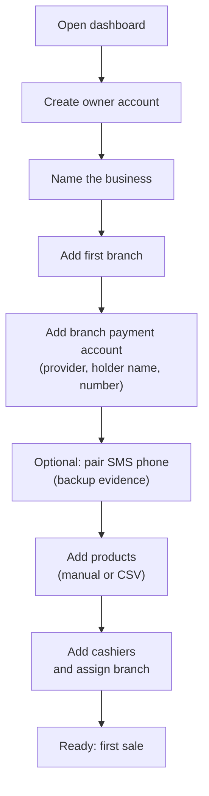
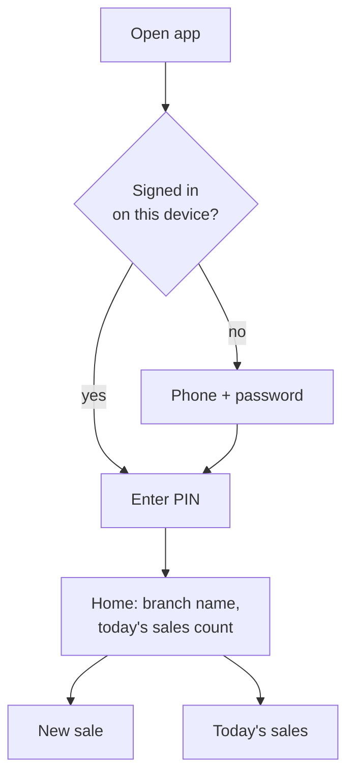
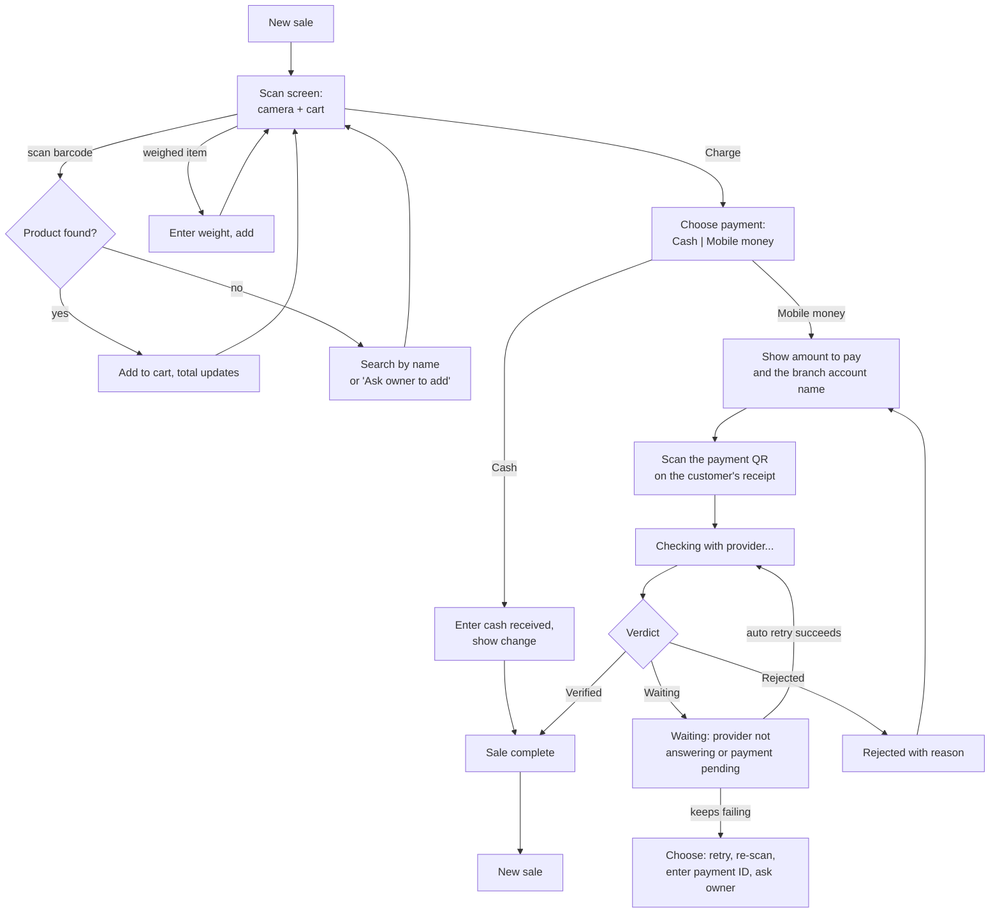
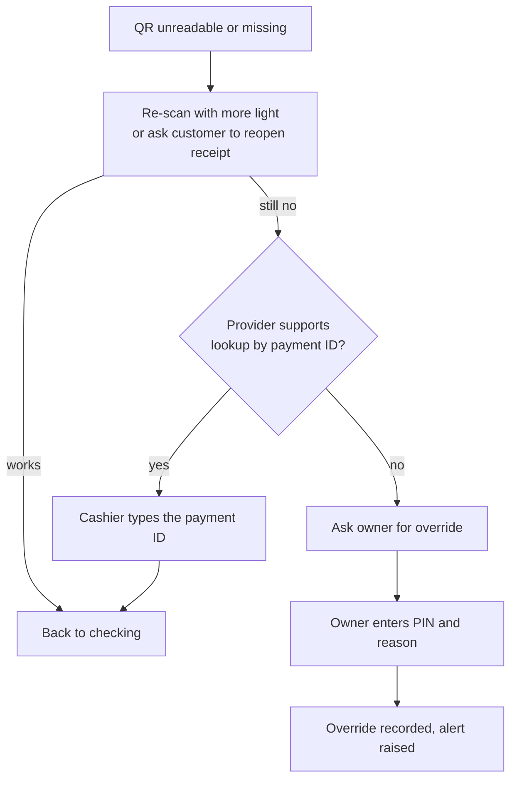
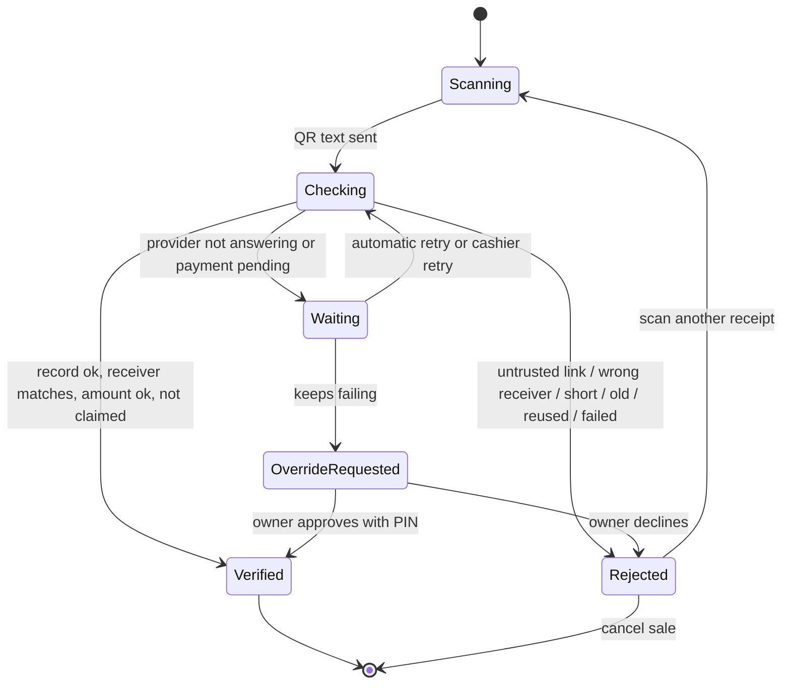
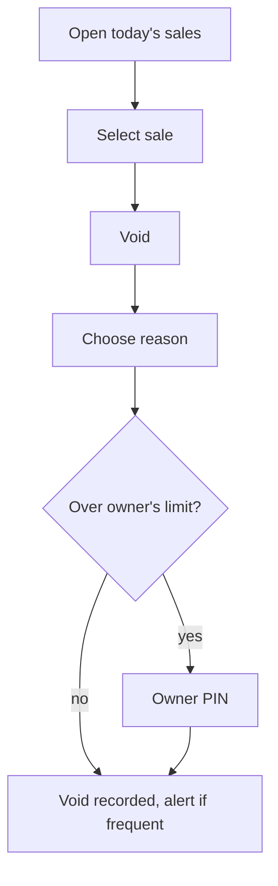
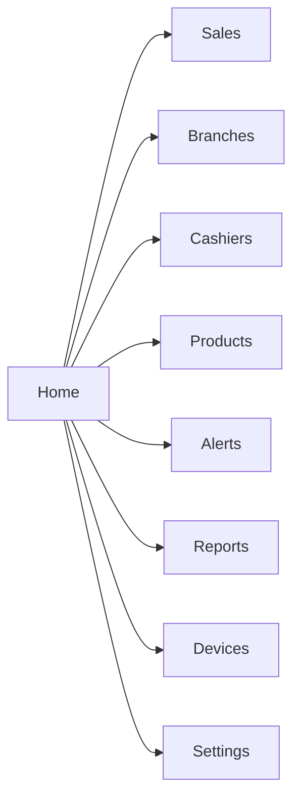
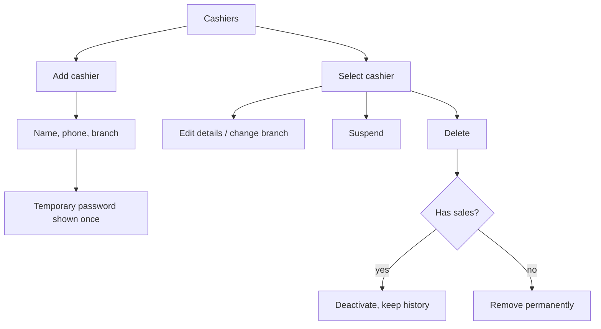
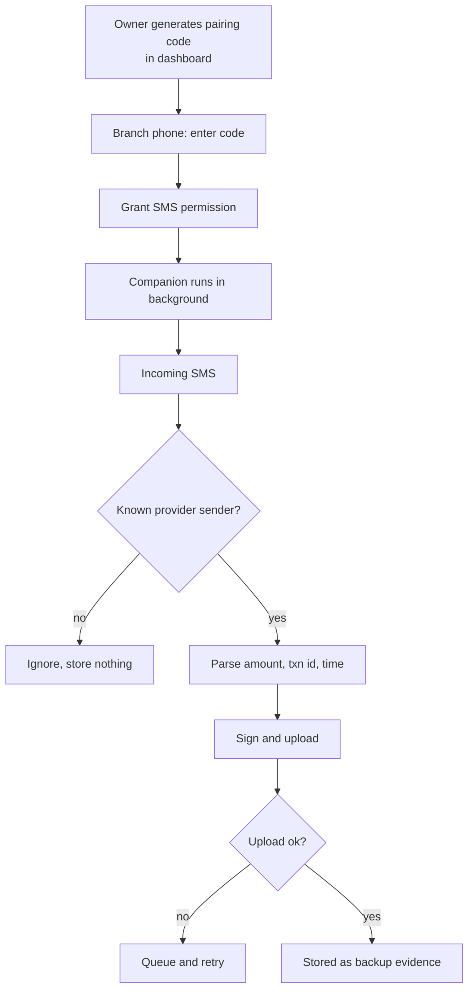

# 03 · App Flow

|             |                                                                             |
| ----------- | --------------------------------------------------------------------------- |
| **Version** | 0.1 draft, 24 Oct 2026                                                      |
| **Related** | [PRD](01-product-requirements.md) · [Design brief](04-uiux-design-brief.md) |

Three surfaces: the **cashier app** (phone), the **owner dashboard** (web, mobile-friendly), and an optional **SMS companion** (background app on the branch phone, backup evidence only).

---

## 1. Surfaces and roles

| Surface                  | Who uses it                                | Main job                                          |
| ------------------------ | ------------------------------------------ | ------------------------------------------------- |
| Cashier app              | Cashier                                    | Sell and verify payments                          |
| Owner dashboard          | Owner                                      | Manage the business and see results               |
| SMS companion (optional) | Nobody directly (set up once by the owner) | Feed payment SMS to the server as backup evidence |

## 2. Owner onboarding

Each step can be skipped and finished later. A checklist on the dashboard home shows what is left, with progress ("3 of 6", the first step already done).

**Onboarding layout rules:** the Back and Continue buttons stay in the same place on every step. Space is reserved for errors and helper text so nothing moves. Fields start with smart defaults (city, time zone, unit). The owner can try a sample sale with sample products before adding payment accounts.

## 3. Cashier: start of day

Locked to one branch. If the account is suspended, the app signs out and says why.

## 4. Cashier: the sale (happy path)

### Screen: Scan and cart

- Top: camera viewfinder with scan area.
- Bottom sheet: cart lines, quantity steppers, running total.
- Bottom: one large **Charge** button showing the total.
- Secondary: search icon, flashlight, clear cart.

### Screen: Payment method

- Total in large figures.
- Two large choices: **Cash**, **Mobile money**.

### Screen: Collect mobile payment

- Shows the **amount to pay** and the **branch account name** the customer should pay.
- Primary action: **Scan payment QR**. Secondary: **Enter payment ID**.

### Screen: Checking and verdict

See section 6.

## 5. When the QR cannot be used

- Entering a payment ID goes through the same checks as a scanned QR. Nothing is skipped.
- Whether lookup by ID is possible depends on each provider and is confirmed in Milestone 0.
- Override is the last resort. It always needs the owner's PIN and a reason, and always raises an alert.
- If the optional SMS companion is built, a **payment inbox** (recent unclaimed payments at this branch) becomes another option, as backup evidence only.

## 6. Payment verification states

| State        | Cashier sees                                       | Can do                                      |
| ------------ | -------------------------------------------------- | ------------------------------------------- |
| **Checking** | Progress, "Checking with provider"                 | Wait, cancel                                |
| **Verified** | Full-screen green verdict, amount, "Complete sale" | Complete                                    |
| **Waiting**  | Amber verdict, one line saying why, countdown      | Retry, re-scan, enter payment ID, ask owner |
| **Rejected** | Red verdict with one plain reason                  | Scan another receipt, cancel sale           |

### Rejection reasons (shown in plain words)

| Code             | Cashier sees                                             |
| ---------------- | -------------------------------------------------------- |
| `UNTRUSTED_LINK` | "This QR isn't from a supported payment provider."       |
| `WRONG_RECEIVER` | "This payment was sent to a different account."          |
| `NOT_SUCCESSFUL` | "The provider shows this payment as not completed."      |
| `TOO_OLD`        | "This payment is too old to use for this sale."          |
| `SHORT`          | "Payment is 40.00 Birr short."                           |
| `REUSED`         | "This payment was already used for another sale."        |
| `UNREADABLE`     | "Can't read this QR. Try again or enter the payment ID." |

### Waiting reasons

| Code                   | Cashier sees                                                           |
| ---------------------- | ---------------------------------------------------------------------- |
| `PROVIDER_UNREACHABLE` | "The provider isn't answering yet. Trying again."                      |
| `PAYMENT_PENDING`      | "The provider shows this payment as pending."                          |
| `OFFLINE`              | "No connection. The payment will be checked when the phone is online." |

## 7. Void and override

Override uses the same pattern: reason plus owner PIN. Both create audit entries and an alert for the owner.

## 8. Offline behaviour

| Situation                 | What the cashier sees                                                                                          |
| ------------------------- | -------------------------------------------------------------------------------------------------------------- |
| Internet lost             | A small banner: "Offline. Sales are saved on this phone."                                                      |
| Cash sale offline         | Completes normally and shows a "Not yet uploaded" mark on the sale                                             |
| Mobile-money sale offline | Scanned QR saved with the sale, marked "Payment not verified yet". Branch policy decides if goods are released |
| Internet returns          | Banner changes to "Syncing 3 sales", then disappears. Verified sales update, any failures are listed           |
| Sync conflict             | Not possible for sales (append-only). Rejected sales are flagged to the owner                                  |

## 9. Owner dashboard navigation

| Section      | Contents                                                                                                                                        |
| ------------ | ----------------------------------------------------------------------------------------------------------------------------------------------- |
| **Home**     | Today, this week, this month: sales, items, income. Branch comparison. Open alerts. Setup checklist for new owners.                             |
| **Sales**    | Searchable list with filters (branch, cashier, method, date). Sale detail with items, payment evidence, and verdict reasons.                    |
| **Branches** | Add, edit, close. **Saved payment accounts** (provider, holder name, number), changed only with the owner's PIN. Assigned cashiers and devices. |
| **Cashiers** | Add, edit, suspend, delete. Reset password and PIN. Performance and void rate.                                                                  |
| **Products** | List, add, edit, import CSV, barcodes, units, prices.                                                                                           |
| **Alerts**   | Reused IDs, rejections, overrides, unusual voids. Mark reviewed or dismissed.                                                                   |
| **Reports**  | Preset ranges, branch and product views, CSV export.                                                                                            |
| **Devices**  | Optional: paired SMS phones, last seen, revoke.                                                                                                 |
| **Settings** | Business profile, void limit, owner PIN, record retention.                                                                                      |

## 10. Cashier management flow (owner)

## 11. SMS companion flow (optional backup)

The companion shows only a simple status screen: paired branch, last message processed, queued count, connection status.

## 12. Screen inventory

| Surface              | Screen                                             | Notes                           |
| -------------------- | -------------------------------------------------- | ------------------------------- |
| Cashier              | Sign in                                            | Phone and password              |
| Cashier              | PIN unlock                                         | Four digits                     |
| Cashier              | Home                                               | Branch, today's count, New sale |
| Cashier              | Scan and cart                                      | Camera, cart sheet, Charge      |
| Cashier              | Product search                                     | When barcode fails              |
| Cashier              | Weighed item entry                                 | Numeric keypad                  |
| Cashier              | Payment method                                     | Cash or mobile money            |
| Cashier              | Cash received                                      | Change calculation              |
| Cashier              | Collect mobile payment                             | Amount and branch account       |
| Cashier              | Scan payment QR                                    | Camera with guide frame         |
| Cashier              | Verdict                                            | Verified, Waiting, Rejected     |
| Cashier              | Enter payment ID                                   | Fallback when there is no QR    |
| Cashier              | Today's sales                                      | With void action                |
| Cashier              | Sync status                                        | Pending uploads                 |
| Owner                | Sign in, onboarding checklist                      |                                 |
| Owner                | Home                                               | Summary and alerts              |
| Owner                | Sales list, sale detail                            |                                 |
| Owner                | Branch list, branch detail, saved payment accounts |                                 |
| Owner                | Cashier list, cashier form                         |                                 |
| Owner                | Product list, product form, import                 |                                 |
| Owner                | Alerts                                             |                                 |
| Owner                | Reports                                            |                                 |
| Owner                | Devices                                            |                                 |
| Owner                | Settings                                           |                                 |
| Companion (optional) | Pairing, status                                    |                                 |

## 13. Error and empty states

| Case                      | Message and action                                                                      |
| ------------------------- | --------------------------------------------------------------------------------------- |
| No products yet (cashier) | "No products on this phone yet. Connect to the internet to download them."              |
| Barcode not found         | "Item not found. Search by name or ask the owner to add it."                            |
| Camera permission denied  | "Camera access is off. Turn it on in Settings to scan."                                 |
| QR unreadable             | "Can't read this QR. Hold steady in good light and try again, or enter the payment ID." |
| Session expired           | "You were signed out. Sign in again to continue." Cart is preserved.                    |
| Branch suspended          | "This branch is closed. Contact the owner."                                             |
| Dashboard with no sales   | "No sales yet today. Sales will appear here as cashiers complete them."                 |

## 14. Loading, feedback, and error behavior

### 14.1 What each screen does while loading

| Screen        | While loading                                                    | Offline                                                | On error                                            |
| ------------- | ---------------------------------------------------------------- | ------------------------------------------------------ | --------------------------------------------------- |
| Scan and cart | Cart skeleton only if the local catalog is not ready             | Works from the phone's catalog                         | Friendly message, cart kept                         |
| Today's sales | 6-row skeleton                                                   | Shows what is on the phone, marked as not yet uploaded | Friendly message, retry                             |
| Verdict       | Verdict-shaped skeleton and a plain status line, never a spinner | "Payment not verified yet"                             | Waiting state, retry, or ask owner                  |
| Owner home    | Stat cards, chart, branch rows, alert rows as skeletons          | Shows an offline banner and the last data seen         | Friendly message and retry on the failed block only |
| Tables        | Header and 10 skeleton rows                                      | Offline banner                                         | Friendly message in place of the table              |
| Forms         | Field-shaped skeletons if data is loading                        | Cannot save, says so                                   | Friendly message, input kept                        |

### 14.2 What is shown before the server answers

| Action                                                    | Shown at once                      | Confirmed by       | If it fails                                    |
| --------------------------------------------------------- | ---------------------------------- | ------------------ | ---------------------------------------------- |
| Scan an item                                              | The line                           | The phone          | Not applicable                                 |
| Change or remove a cart line                              | The change, with undo for remove   | The phone          | Not applicable                                 |
| Complete a cash sale                                      | Sale complete                      | Sync               | Marked "not yet uploaded", retried, never lost |
| Add or edit a product                                     | Updated row                        | Server             | Rolled back with a plain message               |
| Mark an alert reviewed                                    | Reviewed, with undo                | Server             | Restored with a plain message                  |
| **Charge by mobile money**                                | The verdict screen with a skeleton | **Server verdict** | Nothing is shown as Verified                   |
| **Void, override, saved account change, suspend cashier** | Button feedback only               | **Server**         | Plain message, state unchanged                 |

### 14.3 Messages

Every error maps to a friendly message from the table in [the UX brief, section 16](04-uiux-design-brief.md). No technical text, codes, or IDs other than a short reference code.

### 14.4 Smart defaults

| Field                      | Default                         |
| -------------------------- | ------------------------------- |
| Cashier's branch           | The branch they are assigned to |
| Payment provider           | The one used last               |
| Payment time window        | 60 minutes                      |
| Product unit               | Piece                           |
| Quantity                   | 1                               |
| Dashboard range and branch | Today, All branches             |
| City                       | The branch's city               |
| Time zone                  | Africa/Addis_Ababa              |
