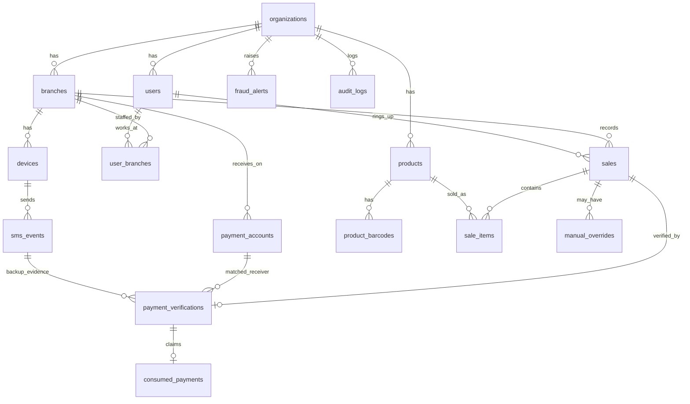

# 05 · Backend Schema

|              |                                                                         |
| ------------ | ----------------------------------------------------------------------- |
| **Database** | PostgreSQL 16 or newer                                                  |
| **Version**  | 0.1 draft, 24 Oct 2026                                                  |
| **Related**  | [TRD](02-technical-requirements.md) · [Guardrails](agent/GUARDRAILS.md) |

---

## 1. Conventions

| Rule     | Detail                                                                                                                              |
| -------- | ----------------------------------------------------------------------------------------------------------------------------------- |
| IDs      | UUID. Sales use client-generated UUID v7 so offline sales keep their identity. Everything else uses `gen_random_uuid()`             |
| Money    | `bigint` in **santim** (1 Birr = 100). Column names end in `_minor`. No floats                                                      |
| Quantity | `numeric(12,3)` to support kilograms and litres                                                                                     |
| Time     | `timestamptz`, stored in UTC. Reports convert to `Africa/Addis_Ababa`                                                               |
| Deletion | Soft delete for anything referenced by a sale                                                                                       |
| Scoping  | Every business table carries `org_id`. All queries filter by it, and **row-level security enforces it in the database** (section 6) |
| Naming   | `snake_case`, plural table names                                                                                                    |

## 2. Entity overview



## 3. Enums

```sql
CREATE TYPE user_role        AS ENUM ('owner', 'manager', 'cashier');
CREATE TYPE user_status      AS ENUM ('active', 'suspended', 'deleted');
CREATE TYPE branch_status    AS ENUM ('active', 'closed');
CREATE TYPE provider         AS ENUM ('telebirr', 'cbe', 'boa', 'awash', 'dashen', 'other');
CREATE TYPE unit_kind        AS ENUM ('piece', 'kg', 'litre', 'pack');
CREATE TYPE sale_status      AS ENUM ('draft', 'awaiting_payment', 'payment_pending', 'paid', 'voided', 'failed');
CREATE TYPE payment_method   AS ENUM ('cash', 'mobile_money');
CREATE TYPE verdict          AS ENUM ('verifying', 'verified', 'waiting', 'rejected', 'manual_override');
CREATE TYPE reject_reason    AS ENUM ('untrusted_link', 'not_successful', 'wrong_receiver', 'too_old',
                                      'short', 'reused', 'unreadable', 'cancelled');
CREATE TYPE verify_source    AS ENUM ('qr', 'payment_id', 'override');
CREATE TYPE device_kind      AS ENUM ('sms_gateway', 'cashier_phone');
CREATE TYPE device_status    AS ENUM ('pending', 'active', 'revoked');
CREATE TYPE sms_event_status AS ENUM ('unclaimed', 'claimed', 'expired', 'held');
CREATE TYPE alert_type       AS ENUM ('reused_payment', 'wrong_receiver', 'untrusted_link', 'rejected_payment',
                                      'override', 'high_void_rate', 'provider_unreachable',
                                      'account_changed', 'suspicious_receipt', 'unknown_sms', 'device_offline');
CREATE TYPE alert_severity   AS ENUM ('info', 'warning', 'critical');
CREATE TYPE alert_status     AS ENUM ('open', 'reviewed', 'dismissed');
```

## 4. Tables

### 4.1 Organizations, users, branches

```sql
CREATE TABLE organizations (
  id            uuid PRIMARY KEY DEFAULT gen_random_uuid(),
  name          text NOT NULL,
  void_pin_limit_minor bigint NOT NULL DEFAULT 0,       -- voids above this need owner PIN
  receipt_retention_days integer NOT NULL DEFAULT 30,
  created_at    timestamptz NOT NULL DEFAULT now()
);

CREATE TABLE users (
  id            uuid PRIMARY KEY DEFAULT gen_random_uuid(),
  org_id        uuid NOT NULL REFERENCES organizations(id),
  role          user_role NOT NULL,
  full_name     text NOT NULL,
  phone         text NOT NULL,
  email         text,
  password_hash text NOT NULL,                          -- Argon2id
  pin_hash      text,                                   -- Argon2id, 4 to 6 digits
  status        user_status NOT NULL DEFAULT 'active',
  failed_logins integer NOT NULL DEFAULT 0,
  locked_until  timestamptz,
  last_login_at timestamptz,
  created_at    timestamptz NOT NULL DEFAULT now(),
  deleted_at    timestamptz,
  UNIQUE (phone)
);
CREATE INDEX users_org_role_idx ON users (org_id, role) WHERE status <> 'deleted';

CREATE TABLE branches (
  id          uuid PRIMARY KEY DEFAULT gen_random_uuid(),
  org_id      uuid NOT NULL REFERENCES organizations(id),
  name        text NOT NULL,
  city        text,
  address     text,
  timezone    text NOT NULL DEFAULT 'Africa/Addis_Ababa',
  status      branch_status NOT NULL DEFAULT 'active',
  created_at  timestamptz NOT NULL DEFAULT now(),
  UNIQUE (org_id, name)
);

CREATE TABLE user_branches (
  user_id    uuid NOT NULL REFERENCES users(id),
  branch_id  uuid NOT NULL REFERENCES branches(id),
  PRIMARY KEY (user_id, branch_id)
);
```

> Application rule: a user with role `cashier` is assigned to exactly one active branch in v1.

### 4.2 Products

```sql
CREATE TABLE products (
  id           uuid PRIMARY KEY DEFAULT gen_random_uuid(),
  org_id       uuid NOT NULL REFERENCES organizations(id),
  name         text NOT NULL,
  name_local   text,                                    -- Amharic or Afaan Oromo name, optional
  sku          text,
  unit         unit_kind NOT NULL DEFAULT 'piece',
  price_minor  bigint NOT NULL CHECK (price_minor >= 0),
  active       boolean NOT NULL DEFAULT true,
  updated_at   timestamptz NOT NULL DEFAULT now(),
  created_at   timestamptz NOT NULL DEFAULT now()
);
CREATE INDEX products_org_name_idx ON products (org_id, lower(name));
CREATE INDEX products_org_updated_idx ON products (org_id, updated_at);   -- incremental sync

CREATE TABLE product_barcodes (
  id          uuid PRIMARY KEY DEFAULT gen_random_uuid(),
  org_id      uuid NOT NULL REFERENCES organizations(id),
  product_id  uuid NOT NULL REFERENCES products(id) ON DELETE CASCADE,
  barcode     text NOT NULL,
  UNIQUE (org_id, barcode)
);

-- Optional (stretch): price override per branch
CREATE TABLE branch_prices (
  branch_id    uuid NOT NULL REFERENCES branches(id),
  product_id   uuid NOT NULL REFERENCES products(id),
  price_minor  bigint NOT NULL CHECK (price_minor >= 0),
  PRIMARY KEY (branch_id, product_id)
);
```

### 4.3 Payment accounts and devices

```sql
-- The receiving accounts the owner saves for each branch. Receiver matching uses these.
CREATE TABLE payment_accounts (
  id                    uuid PRIMARY KEY DEFAULT gen_random_uuid(),
  org_id                uuid NOT NULL REFERENCES organizations(id),
  branch_id             uuid NOT NULL REFERENCES branches(id),
  provider              provider NOT NULL,
  display_label         text NOT NULL,                  -- what the cashier and customer see, e.g. "Bole Branch"
  holder_name           text NOT NULL,                  -- as registered with the provider
  holder_name_normalized text NOT NULL,                 -- lowercased, punctuation and spacing removed
  account_ref_enc       bytea NOT NULL,                 -- account or phone number, encrypted at rest
  account_ref_last4     text NOT NULL,                  -- shown in the UI and used for masked matching
  active                boolean NOT NULL DEFAULT true,
  created_by            uuid REFERENCES users(id),
  created_at            timestamptz NOT NULL DEFAULT now(),
  UNIQUE (branch_id, provider, account_ref_last4)
);

-- Optional (backup evidence only): branch phones that run the SMS companion
CREATE TABLE devices (
  id            uuid PRIMARY KEY DEFAULT gen_random_uuid(),
  org_id        uuid NOT NULL REFERENCES organizations(id),
  branch_id     uuid NOT NULL REFERENCES branches(id),
  kind          device_kind NOT NULL,
  name          text NOT NULL,
  secret_hash   text,                                   -- hash of the HMAC secret issued at pairing
  pairing_code_hash text,
  pairing_expires_at timestamptz,
  status        device_status NOT NULL DEFAULT 'pending',
  last_seen_at  timestamptz,
  created_at    timestamptz NOT NULL DEFAULT now()
);

-- Allowlist of official provider hosts used by the verification service
CREATE TABLE provider_hosts (
  id          uuid PRIMARY KEY DEFAULT gen_random_uuid(),
  provider    provider NOT NULL,
  host        text NOT NULL UNIQUE,                     -- exact hostname, no wildcards
  active      boolean NOT NULL DEFAULT true,
  parser_key  text NOT NULL,                            -- which parser configuration to use
  added_at    timestamptz NOT NULL DEFAULT now()
);
```

Changes to `payment_accounts` are audit-logged, need the owner's PIN, and raise an `account_changed` alert, because they decide which payments are accepted.

### 4.4 SMS events (optional backup evidence)

```sql
CREATE TABLE sms_events (
  id               uuid PRIMARY KEY DEFAULT gen_random_uuid(),
  org_id           uuid NOT NULL REFERENCES organizations(id),
  branch_id        uuid NOT NULL REFERENCES branches(id),
  device_id        uuid NOT NULL REFERENCES devices(id),
  provider         provider NOT NULL,
  provider_txn_id  text NOT NULL,
  amount_minor     bigint NOT NULL CHECK (amount_minor > 0),
  currency         char(3) NOT NULL DEFAULT 'ETB',
  counterparty_masked text,                             -- e.g. "Abe*** T."
  event_time       timestamptz NOT NULL,                -- time stated in the SMS
  received_at      timestamptz NOT NULL DEFAULT now(),
  raw_sha256       char(64) NOT NULL,                   -- hash only, raw text not stored
  parse_confidence numeric(4,3) NOT NULL,
  status           sms_event_status NOT NULL DEFAULT 'unclaimed',
  claimed_by_sale_id uuid,
  UNIQUE (provider, provider_txn_id)
);
CREATE INDEX sms_events_inbox_idx ON sms_events (branch_id, received_at DESC) WHERE status = 'unclaimed';
```

### 4.5 Sales

```sql
CREATE TABLE sales (
  id               uuid PRIMARY KEY,                    -- client-generated UUID v7
  org_id           uuid NOT NULL REFERENCES organizations(id),
  branch_id        uuid NOT NULL REFERENCES branches(id),
  cashier_id       uuid NOT NULL REFERENCES users(id),
  device_id        uuid REFERENCES devices(id),
  status           sale_status NOT NULL DEFAULT 'draft',
  payment_method   payment_method,
  subtotal_minor   bigint NOT NULL DEFAULT 0 CHECK (subtotal_minor >= 0),
  total_minor      bigint NOT NULL DEFAULT 0 CHECK (total_minor >= 0),
  cash_received_minor bigint,
  overpaid_minor   bigint NOT NULL DEFAULT 0,
  idempotency_key  text NOT NULL,
  client_created_at timestamptz NOT NULL,
  completed_at     timestamptz,
  voided_at        timestamptz,
  void_reason      text,
  voided_by        uuid REFERENCES users(id),
  created_at       timestamptz NOT NULL DEFAULT now(),
  UNIQUE (org_id, idempotency_key)
);
CREATE INDEX sales_branch_time_idx  ON sales (branch_id, completed_at DESC);
CREATE INDEX sales_cashier_time_idx ON sales (cashier_id, completed_at DESC);
CREATE INDEX sales_org_time_idx     ON sales (org_id, completed_at DESC);

CREATE TABLE sale_items (
  id                 uuid PRIMARY KEY DEFAULT gen_random_uuid(),
  sale_id            uuid NOT NULL REFERENCES sales(id) ON DELETE CASCADE,
  product_id         uuid REFERENCES products(id),
  name_snapshot      text NOT NULL,                     -- keeps history if the product changes
  barcode_snapshot   text,
  unit               unit_kind NOT NULL,
  unit_price_minor   bigint NOT NULL CHECK (unit_price_minor >= 0),
  quantity           numeric(12,3) NOT NULL CHECK (quantity > 0),
  line_total_minor   bigint NOT NULL CHECK (line_total_minor >= 0)
);
CREATE INDEX sale_items_sale_idx    ON sale_items (sale_id);
CREATE INDEX sale_items_product_idx ON sale_items (product_id);
```

> Completed sales are immutable. A trigger rejects `UPDATE` and `DELETE` on `sale_items`, and on `sales` rows with status `paid`, except for the void columns.

### 4.6 Payment verification

```sql
CREATE TABLE payment_verifications (
  id                    uuid PRIMARY KEY DEFAULT gen_random_uuid(),
  org_id                uuid NOT NULL REFERENCES organizations(id),
  sale_id               uuid NOT NULL REFERENCES sales(id),
  attempt_no            integer NOT NULL DEFAULT 1,
  source                verify_source NOT NULL DEFAULT 'qr',
  provider              provider,
  -- what was scanned (the full QR text is hashed, not stored)
  qr_ref_sha256         char(64),
  qr_host               text,
  qr_path_pattern       text,                           -- path with ids and tokens removed
  -- what the provider record said
  provider_txn_id       text,
  provider_status       text,
  amount_minor          bigint,
  paid_at               timestamptz,
  receiver_name_masked  text,
  receiver_ref_masked   text,
  payer_name_masked     text,
  -- how it was fetched
  fetch_http_status     smallint,
  fetched_at            timestamptz,
  parser_version        text,
  -- what we decided
  matched_account_id    uuid REFERENCES payment_accounts(id),
  receiver_match        boolean,
  amount_ok             boolean,
  time_ok               boolean,
  verdict               verdict NOT NULL DEFAULT 'verifying',
  reject_reason         reject_reason,
  reasons               text[] NOT NULL DEFAULT '{}',
  decided_at            timestamptz,
  -- optional backup evidence
  sms_event_id          uuid REFERENCES sms_events(id),
  receipt_image_key     text,
  forensic_risk         numeric(4,3),                   -- advisory only
  created_at            timestamptz NOT NULL DEFAULT now(),
  UNIQUE (sale_id, attempt_no)
);
CREATE INDEX pv_sale_idx ON payment_verifications (sale_id);
CREATE INDEX pv_txn_idx  ON payment_verifications (provider, provider_txn_id);

-- The one-use guard. A transaction ID can be consumed once, across the whole system.
CREATE TABLE consumed_payments (
  provider         provider NOT NULL,
  provider_txn_id  text NOT NULL,
  org_id           uuid NOT NULL REFERENCES organizations(id),
  sale_id          uuid NOT NULL REFERENCES sales(id),
  verification_id  uuid REFERENCES payment_verifications(id),
  amount_minor     bigint NOT NULL,
  consumed_at      timestamptz NOT NULL DEFAULT now(),
  PRIMARY KEY (provider, provider_txn_id)
);
```

The claim is a single transaction: insert into `consumed_payments`, set the verification verdict to `verified`, set the sale to `paid`. A duplicate insert violates the primary key and the whole transaction rolls back. This is what makes reuse impossible even under concurrent requests from two branches.

A verification can only reach `verified` if `receiver_match`, `amount_ok`, and `time_ok` are all true. A check constraint and a test enforce that.

### 4.7 Overrides, alerts, audit

```sql
CREATE TABLE manual_overrides (
  id            uuid PRIMARY KEY DEFAULT gen_random_uuid(),
  org_id        uuid NOT NULL REFERENCES organizations(id),
  sale_id       uuid NOT NULL REFERENCES sales(id),
  requested_by  uuid NOT NULL REFERENCES users(id),
  approved_by   uuid NOT NULL REFERENCES users(id),
  reason        text NOT NULL,
  created_at    timestamptz NOT NULL DEFAULT now()
);

CREATE TABLE fraud_alerts (
  id          uuid PRIMARY KEY DEFAULT gen_random_uuid(),
  org_id      uuid NOT NULL REFERENCES organizations(id),
  branch_id   uuid REFERENCES branches(id),
  sale_id     uuid REFERENCES sales(id),
  cashier_id  uuid REFERENCES users(id),
  type        alert_type NOT NULL,
  severity    alert_severity NOT NULL DEFAULT 'warning',
  details     jsonb NOT NULL DEFAULT '{}',
  status      alert_status NOT NULL DEFAULT 'open',
  reviewed_by uuid REFERENCES users(id),
  created_at  timestamptz NOT NULL DEFAULT now()
);
CREATE INDEX alerts_org_open_idx ON fraud_alerts (org_id, created_at DESC) WHERE status = 'open';

CREATE TABLE audit_logs (
  id           bigserial PRIMARY KEY,
  org_id       uuid NOT NULL,
  actor_id     uuid,
  actor_role   user_role,
  action       text NOT NULL,                           -- e.g. 'sale.void', 'cashier.delete'
  entity_type  text NOT NULL,
  entity_id    text,
  meta         jsonb NOT NULL DEFAULT '{}',
  ip           inet,
  created_at   timestamptz NOT NULL DEFAULT now()
);
-- Append-only: the application role has INSERT and SELECT only on audit_logs.

CREATE TABLE refresh_tokens (
  id          uuid PRIMARY KEY DEFAULT gen_random_uuid(),
  user_id     uuid NOT NULL REFERENCES users(id),
  token_hash  text NOT NULL,
  device_info text,
  expires_at  timestamptz NOT NULL,
  revoked_at  timestamptz,
  replaced_by uuid,
  created_at  timestamptz NOT NULL DEFAULT now()
);
```

## 5. Reporting views

```sql
CREATE VIEW v_sales_daily AS
SELECT s.org_id,
       s.branch_id,
       (s.completed_at AT TIME ZONE b.timezone)::date AS day,
       count(*)                                        AS sales_count,
       sum(s.total_minor)                              AS income_minor,
       sum(s.total_minor) FILTER (WHERE s.payment_method = 'cash')         AS cash_minor,
       sum(s.total_minor) FILTER (WHERE s.payment_method = 'mobile_money') AS mobile_minor
FROM sales s
JOIN branches b ON b.id = s.branch_id
WHERE s.status = 'paid'
GROUP BY s.org_id, s.branch_id, day;

CREATE VIEW v_product_sales_daily AS
SELECT s.org_id, s.branch_id,
       (s.completed_at AT TIME ZONE b.timezone)::date AS day,
       si.product_id, si.name_snapshot,
       sum(si.quantity)         AS quantity,
       sum(si.line_total_minor) AS revenue_minor
FROM sale_items si
JOIN sales s    ON s.id = si.sale_id AND s.status = 'paid'
JOIN branches b ON b.id = s.branch_id
GROUP BY s.org_id, s.branch_id, day, si.product_id, si.name_snapshot;
```

Weekly and monthly numbers are queries over these views. If dashboards get slow, convert them to materialized views refreshed on a schedule.

## 6. Row-level security

Row-level security (RLS) makes the database itself filter rows by who is asking. A forgotten `WHERE` in the API then returns nothing instead of leaking data. See [SECURITY.md](../SECURITY.md) rules S2, S3, and S5.

### 6.1 Principles

- RLS is **enabled and forced** on every table, including for the table owner.
- The API connects as `app_api`, a role that is **not** a superuser, does **not** own the tables, and has `NOBYPASSRLS`.
- Tables are owned by a separate `migrator` role used only by migrations.
- Each request opens a transaction and sets the session context with `SET LOCAL`. If the context is missing, the helper functions return `NULL`, every policy fails, and **no rows are visible**. Failing closed is the default.
- A `RESTRICTIVE` business-isolation policy sits on every table with `org_id`. It is combined with `AND` on top of the role policies, so no role policy can ever cross a business boundary.
- The verification service has **no** database access. It returns evidence through the API.

### 6.2 Roles, helpers, and context

```sql
CREATE ROLE migrator NOLOGIN;                         -- owns the tables, runs migrations
CREATE ROLE app_api  LOGIN NOSUPERUSER NOBYPASSRLS;   -- the API's runtime role

-- Set by the API at the start of every request transaction:
--   SET LOCAL app.org_id     = '<uuid>';
--   SET LOCAL app.user_id    = '<uuid>';          -- or the device id for the optional SMS companion
--   SET LOCAL app.role       = 'owner' | 'manager' | 'cashier' | 'device';
--   SET LOCAL app.branch_ids = '{<uuid>,<uuid>}'; -- the branches this user or device may act in

CREATE FUNCTION app_org()      RETURNS uuid   LANGUAGE sql STABLE AS
  $$ SELECT NULLIF(current_setting('app.org_id', true), '')::uuid $$;
CREATE FUNCTION app_user()     RETURNS uuid   LANGUAGE sql STABLE AS
  $$ SELECT NULLIF(current_setting('app.user_id', true), '')::uuid $$;
CREATE FUNCTION app_role()     RETURNS text   LANGUAGE sql STABLE AS
  $$ SELECT NULLIF(current_setting('app.role', true), '') $$;
CREATE FUNCTION app_branches() RETURNS uuid[] LANGUAGE sql STABLE AS
  $$ SELECT COALESCE(NULLIF(current_setting('app.branch_ids', true), '')::uuid[], '{}'::uuid[]) $$;
```

Sign-in, token refresh, and owner registration happen **before** a context exists, so they run through a few `SECURITY DEFINER` functions (`auth_login`, `auth_refresh`, `register_owner`) that do exactly one job each and return only what the caller needs.

### 6.3 Turn RLS on for every table

```sql
DO $$
DECLARE t text;
BEGIN
  FOREACH t IN ARRAY ARRAY[
    'organizations','users','branches','user_branches','products','product_barcodes','branch_prices',
    'payment_accounts','provider_hosts','devices','sms_events','sales','sale_items',
    'payment_verifications','consumed_payments','manual_overrides','fraud_alerts',
    'audit_logs','refresh_tokens'
  ] LOOP
    EXECUTE format('ALTER TABLE %I ENABLE ROW LEVEL SECURITY', t);
    EXECUTE format('ALTER TABLE %I FORCE  ROW LEVEL SECURITY', t);
  END LOOP;
END $$;

-- Business isolation: restrictive, applies on top of every other policy
DO $$
DECLARE t text;
BEGIN
  FOREACH t IN ARRAY ARRAY[
    'users','branches','products','product_barcodes','payment_accounts','devices','sms_events',
    'sales','payment_verifications','consumed_payments','manual_overrides','fraud_alerts','audit_logs'
  ] LOOP
    EXECUTE format(
      'CREATE POLICY org_isolation ON %I AS RESTRICTIVE
         USING (org_id = app_org()) WITH CHECK (org_id = app_org())', t);
  END LOOP;
END $$;
```

### 6.4 Policies per table

**Organizations and people**

```sql
-- organizations
CREATE POLICY org_read   ON organizations FOR SELECT USING (id = app_org());
CREATE POLICY org_update ON organizations FOR UPDATE
  USING (id = app_org() AND app_role() = 'owner') WITH CHECK (id = app_org());

-- users: owner manages everyone in the business, others read only themselves
CREATE POLICY users_owner_all  ON users FOR ALL
  USING (app_role() = 'owner') WITH CHECK (app_role() = 'owner');
CREATE POLICY users_self_read  ON users FOR SELECT USING (id = app_user());

-- branches
CREATE POLICY branches_owner_all ON branches FOR ALL
  USING (app_role() = 'owner') WITH CHECK (app_role() = 'owner');
CREATE POLICY branches_staff_read ON branches FOR SELECT
  USING (id = ANY (app_branches()));

-- user_branches (no org_id column, so check through branches)
CREATE POLICY ub_owner_all ON user_branches FOR ALL
  USING (app_role() = 'owner' AND EXISTS (SELECT 1 FROM branches b WHERE b.id = branch_id))
  WITH CHECK (app_role() = 'owner' AND EXISTS (SELECT 1 FROM branches b WHERE b.id = branch_id));
CREATE POLICY ub_self_read ON user_branches FOR SELECT USING (user_id = app_user());
```

**Catalog**

```sql
-- products and barcodes: everyone in the business can read, only the owner writes
CREATE POLICY products_read  ON products FOR SELECT
  USING (app_role() IN ('owner','manager','cashier'));
CREATE POLICY products_write ON products FOR ALL
  USING (app_role() = 'owner') WITH CHECK (app_role() = 'owner');

CREATE POLICY barcodes_read  ON product_barcodes FOR SELECT
  USING (app_role() IN ('owner','manager','cashier'));
CREATE POLICY barcodes_write ON product_barcodes FOR ALL
  USING (app_role() = 'owner') WITH CHECK (app_role() = 'owner');

-- branch_prices: through branches
CREATE POLICY bp_read  ON branch_prices FOR SELECT
  USING (branch_id = ANY (app_branches()) OR app_role() = 'owner');
CREATE POLICY bp_write ON branch_prices FOR ALL
  USING (app_role() = 'owner' AND EXISTS (SELECT 1 FROM branches b WHERE b.id = branch_id))
  WITH CHECK (app_role() = 'owner' AND EXISTS (SELECT 1 FROM branches b WHERE b.id = branch_id));
```

**Payment accounts, hosts, devices**

```sql
-- payment_accounts: owner manages. Staff may read their own branch's rows, but the API serves
-- staff from the view payment_accounts_public, which omits account_ref_enc and holder details.
CREATE POLICY pa_owner_all  ON payment_accounts FOR ALL
  USING (app_role() = 'owner') WITH CHECK (app_role() = 'owner');
CREATE POLICY pa_staff_read ON payment_accounts FOR SELECT
  USING (branch_id = ANY (app_branches()));

CREATE VIEW payment_accounts_public WITH (security_barrier = true) AS
  SELECT id, org_id, branch_id, provider, display_label, account_ref_last4, active
  FROM payment_accounts;

-- provider_hosts: readable by the API, written only by migrations
CREATE POLICY ph_read ON provider_hosts FOR SELECT USING (true);

-- devices (optional SMS companion)
CREATE POLICY devices_owner_all ON devices FOR ALL
  USING (app_role() = 'owner') WITH CHECK (app_role() = 'owner');
CREATE POLICY devices_self_read ON devices FOR SELECT
  USING (app_role() = 'device' AND id = app_user());
```

**Sales and payments**

```sql
-- sales
CREATE POLICY sales_owner_all ON sales FOR ALL
  USING (app_role() = 'owner') WITH CHECK (app_role() = 'owner');
CREATE POLICY sales_cashier_read ON sales FOR SELECT
  USING (branch_id = ANY (app_branches()) AND cashier_id = app_user());
CREATE POLICY sales_cashier_insert ON sales FOR INSERT
  WITH CHECK (app_role() = 'cashier' AND branch_id = ANY (app_branches()) AND cashier_id = app_user());
CREATE POLICY sales_cashier_update ON sales FOR UPDATE
  USING (app_role() = 'cashier' AND branch_id = ANY (app_branches()) AND cashier_id = app_user())
  WITH CHECK (branch_id = ANY (app_branches()) AND cashier_id = app_user());

-- sale_items: visible and writable exactly when the parent sale is (the sales policies apply inside EXISTS)
CREATE POLICY si_access ON sale_items FOR ALL
  USING (EXISTS (SELECT 1 FROM sales s WHERE s.id = sale_id))
  WITH CHECK (EXISTS (SELECT 1 FROM sales s WHERE s.id = sale_id));

-- payment_verifications: through the sale
CREATE POLICY pv_access ON payment_verifications FOR ALL
  USING (EXISTS (SELECT 1 FROM sales s WHERE s.id = sale_id))
  WITH CHECK (EXISTS (SELECT 1 FROM sales s WHERE s.id = sale_id));

-- consumed_payments: insert only through the claim, read by the owner. No update, no delete.
CREATE POLICY cp_insert ON consumed_payments FOR INSERT
  WITH CHECK (EXISTS (SELECT 1 FROM sales s WHERE s.id = sale_id));
CREATE POLICY cp_owner_read ON consumed_payments FOR SELECT USING (app_role() = 'owner');

-- manual_overrides
CREATE POLICY mo_owner_all ON manual_overrides FOR ALL
  USING (app_role() = 'owner') WITH CHECK (app_role() = 'owner');
CREATE POLICY mo_requester_read ON manual_overrides FOR SELECT USING (requested_by = app_user());
```

**Optional SMS events, alerts, audit, sessions**

```sql
-- sms_events (optional backup evidence)
CREATE POLICY sms_owner_all ON sms_events FOR ALL
  USING (app_role() = 'owner') WITH CHECK (app_role() = 'owner');
CREATE POLICY sms_staff_read ON sms_events FOR SELECT
  USING (branch_id = ANY (app_branches()) AND status = 'unclaimed');
CREATE POLICY sms_device_insert ON sms_events FOR INSERT
  WITH CHECK (app_role() = 'device' AND branch_id = ANY (app_branches()));

-- fraud_alerts: raised by the system for any signed-in actor, read and reviewed by the owner
CREATE POLICY fa_insert ON fraud_alerts FOR INSERT WITH CHECK (true);
CREATE POLICY fa_owner  ON fraud_alerts FOR SELECT USING (app_role() = 'owner');
CREATE POLICY fa_review ON fraud_alerts FOR UPDATE
  USING (app_role() = 'owner') WITH CHECK (app_role() = 'owner');

-- audit_logs: append-only. Insert by anyone in the business, read by the owner. No update or delete policy.
CREATE POLICY audit_insert ON audit_logs FOR INSERT WITH CHECK (true);
CREATE POLICY audit_read   ON audit_logs FOR SELECT USING (app_role() = 'owner');

-- refresh_tokens: a user sees only their own, the rest goes through the auth functions
CREATE POLICY rt_self ON refresh_tokens FOR ALL
  USING (user_id = app_user()) WITH CHECK (user_id = app_user());
```

The `org_isolation` restrictive policy from 6.3 is in force on every one of these tables as well.

### 6.5 Grants (least privilege)

```sql
GRANT USAGE ON SCHEMA public TO app_api;
GRANT SELECT, INSERT, UPDATE ON ALL TABLES IN SCHEMA public TO app_api;

-- Take away what the API must never do
REVOKE UPDATE, DELETE ON audit_logs, consumed_payments FROM app_api;
REVOKE DELETE ON sales, sale_items, payment_verifications FROM app_api;
REVOKE INSERT, UPDATE, DELETE ON provider_hosts FROM app_api;
```

Soft deletion (a status or `deleted_at`) is used instead of `DELETE` for users, branches, and products.

### 6.6 What RLS does and does not cover

| It covers                                                                         | It does not replace                                                      |
| --------------------------------------------------------------------------------- | ------------------------------------------------------------------------ |
| Business and branch separation, role limits, fail-closed default                  | API authorization, which stays on                                        |
| Mistakes in API queries                                                           | Input validation                                                         |
| A compromised API role being unable to read other businesses' rows in one request | Protection if the database superuser or the migrator role is compromised |

A unique-violation on `consumed_payments` can tell a caller that a transaction ID was already used, even by another business. The API reports it only as "already used" and nothing more. This small exposure is accepted and documented.

### 6.7 Performance notes

- Every `org_id`, `branch_id`, and `sale_id` used by a policy has an index.
- The helper functions are `STABLE` and read settings that are fixed for the transaction.
- `EXISTS` through `sales` is cheap with the indexes above. Measure it in the performance tests and simplify if needed.

### 6.8 Policy tests (required)

```sql
-- CI check: every table must have RLS on and at least one policy
SELECT c.relname
FROM pg_class c
JOIN pg_namespace n ON n.oid = c.relnamespace
WHERE n.nspname = 'public' AND c.relkind = 'r'
  AND (NOT c.relrowsecurity OR NOT c.relforcerowsecurity
       OR NOT EXISTS (SELECT 1 FROM pg_policy p WHERE p.polrelid = c.oid));
-- Expect zero rows.
```

A test suite (pgTAP or a script) switches the session context to each role and checks, for every table: allowed rows are visible, rows from another branch or business are not, writes outside the role's rights fail, and with **no context set** every table returns zero rows.

## 7. Integrity rules

| Rule                                                          | How it is enforced                                                                                            |
| ------------------------------------------------------------- | ------------------------------------------------------------------------------------------------------------- |
| A transaction ID is used once                                 | Primary key on `consumed_payments`                                                                            |
| A verified payment went to one of the branch's saved accounts | `receiver_match` must be true before `verified`, enforced by a constraint and tests                           |
| Only official provider hosts are fetched                      | `provider_hosts` allowlist, checked by the verification service                                               |
| An SMS event is stored once (optional feature)                | Unique `(provider, provider_txn_id)` on `sms_events`                                                          |
| A sale syncs once                                             | Unique `(org_id, idempotency_key)` on `sales`                                                                 |
| Barcodes are unique per business                              | Unique `(org_id, barcode)`                                                                                    |
| Cashier sells only at their branch                            | API check **and** a row-level security policy, plus a test that tries to break both                           |
| Every table has row-level security and policies               | CI query lists any table without RLS and fails the build                                                      |
| Completed sales cannot be edited                              | Trigger plus a database role without update rights                                                            |
| Audit log cannot be edited                                    | Application role has insert and select only                                                                   |
| Totals are correct                                            | `total_minor` must equal the sum of `line_total_minor`, checked in the API and in a nightly consistency query |

## 8. Retention

| Data                                          | Kept                                                          |
| --------------------------------------------- | ------------------------------------------------------------- |
| Sales, items, audit logs                      | Indefinitely (business records)                               |
| Provider record copies and any receipt images | `receipt_retention_days`, then deleted. Extracted fields stay |
| Full QR text and raw SMS text                 | Never stored. Only a hash and parsed or redacted fields       |
| Refresh tokens                                | Until expiry, then purged                                     |

## 9. Migration and seed plan

1. `0001_core`: organizations, users, branches, user_branches
2. `0002_catalog`: products, barcodes
3. `0003_sales`: sales, sale_items, immutability trigger
4. `0004_payments`: payment accounts, provider hosts, verifications, consumed_payments. (`devices` and `sms_events` move to a later optional migration)
5. `0005_alerts_audit`: alerts, overrides, audit logs, refresh tokens
6. `0006_views`: reporting views
7. `0007_rls`: database roles, session helpers, enable and force RLS on every table, all policies, grants. Any later migration that adds a table must add its policies in the same migration

Seed data is synthetic only: one business, three branches, five cashiers, 200 products with realistic Ethiopian grocery names, and a generated month of sales for dashboard development.
