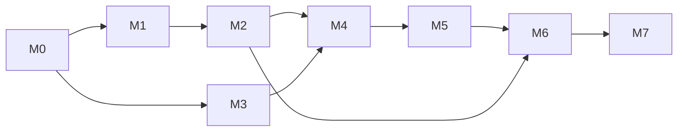

# 06 · Implementation Plan

|              |                                                                                           |
| ------------ | ----------------------------------------------------------------------------------------- |
| **Version**  | 0.1 draft, 24 Oct 2026                                                                    |
| **Builders** | The student and Claude                                                                    |
| **Gate**     | Nothing in `apps/` or `services/` is written until the student says **"start building."** |

---

## 1. How we work

| Who             | Does what                                                                                                                                                                                                      |
| --------------- | -------------------------------------------------------------------------------------------------------------------------------------------------------------------------------------------------------------- |
| **Claude**      | Writes code, migrations, tests, and docs in the working environment. Runs tests and evals there. Explains choices and flags risks.                                                                             |
| **The student** | Decides scope, runs apps on real phones, collects real receipts and checks what their QR codes lead to, talks to shop owners, reviews each milestone, and keeps the proposal and report in sync with the work. |

**Working agreement**

- Build in the order below. Each milestone ends with a working, demonstrable slice.
- At the end of each milestone: tests pass, [MEMORY.md](agent/MEMORY.md) is updated, and the student does a short review before the next one starts.
- Anything that needs a physical phone, a real receipt, or a real shop is listed under "Needs you" so it is not discovered late.

## 2. Mapping to the academic calendar

| Period         | Output                                                                                                                                                    |
| -------------- | --------------------------------------------------------------------------------------------------------------------------------------------------------- |
| **Semester 1** | Proposal, requirements, design, schema, verification feasibility spike, and a first prototype of the cashier flow. A working application is not required. |
| **Semester 2** | Full implementation, evaluation, usability tests, thesis, and final demo.                                                                                 |

Milestones 0 to 2 fit semester 1. Milestones 3 to 7 are semester 2.

## 3. Milestones

### M0 · Discovery and feasibility spike

**Goal:** test **Assumption A1** (the payment QR links to a readable provider receipt page) with real receipts before anything else is designed or built.

| Task                                   | Detail                                                                                                                                                                                                   |
| -------------------------------------- | -------------------------------------------------------------------------------------------------------------------------------------------------------------------------------------------------------- |
| Scan real QR codes                     | Scan the QR on 20+ genuine Telebirr and CBE receipts, across amounts and phones. Record what each QR contains: a link, which host, which path pattern                                                    |
| Open the links                         | In a private browser window, not logged in. Note what the page shows (transaction ID, amount, time, status, receiver), whether it needs login, captcha, or JavaScript, and how long the link stays valid |
| Fetch from a script                    | Try `curl` or a small script. Does it return the same data without a browser?                                                                                                                            |
| Lookup by ID                           | Is there any way to look up a payment by transaction ID alone, for receipts with no QR?                                                                                                                  |
| Provider rules                         | Check each provider's terms and any rate limits for automated access                                                                                                                                     |
| Receiver details                       | What does the page show for the receiver: name, account, or phone, full or masked?                                                                                                                       |
| Interview 2 shop owners and 2 cashiers | Real checkout flow, branch accounts, void habits                                                                                                                                                         |
| Check past-project list                | Confirm the difference from _Real Time Stock Management System_ and similar                                                                                                                              |

**Needs you:** real receipts, a laptop and phone for the checks, shop visits, the past-project list.
**Done when:** a one-page findings note records A1 as **confirmed**, **partly true**, or **false**, with the list of fields each provider page gives and the allowlisted hostnames.
**Decision point:** if A1 is false or only partly true, the team switches to the fallback design in [TRD section 4.8](02-technical-requirements.md), and the plan inserts the SMS companion and OCR work before M5.

### M1 · Foundation

**Goal:** a repo that runs end to end with nothing in it yet.

- Monorepo, linting, formatting, TypeScript strict mode, CI.
- Docker Compose with Postgres, Redis, and the API.
- Migrations `0001` to `0003`, seed data.
- Auth: owner registration, login, refresh, cashier login, PIN.
- Role and branch authorization layer with its first tests.
- Shared types package and money helpers with full test coverage.
- **Security baseline (see [SECURITY.md](../SECURITY.md)):** the `payproof_app` database role (no superuser, no bypass), row-level security enabled and forced on every table with policies and tests, request-context setting per transaction, rate limiting on every endpoint in a shared store, Zod validation at every boundary, an error-mapping layer that returns codes, safe messages, and reference IDs, secret scanning in CI, and a pre-commit block on `.env` and key-like strings.
- **Speed baseline:** response compression, lean payloads, and the web app configured as a static export.

**Done when:** an owner can register and log in, create a branch, create a cashier, and the cashier can log in and see only their branch. Cross-branch access tests pass at both the API and the database level. Exceeding a rate limit returns a friendly 429. A forced server error shows no technical text. The secret scan has zero findings.

### M2 · Catalog and cashier sale (single branch, cash only)

**Goal:** the sale flow without payment verification.

- Product CRUD, barcodes, CSV import.
- Cashier app: sign-in, PIN, scan, cart, weighed items, search, cash payment, today's sales.
- Local SQLite catalog cache and sales outbox with idempotent sync.
- Basic owner dashboard: sales list and today's totals.
- **Experience baseline:** skeleton components for every data screen, instant tap feedback, optimistic cart and cash sale, fixed-layout onboarding with progress and smart defaults, and the lint rule that bans spinners where the layout is known.

**Needs you:** test on real Android phones, with real barcodes from products at home.
**Done when:** a cashier can sell three items including a weighed one in under 45 seconds, and sales appear on the dashboard. A sale made in airplane mode syncs once, only once.

**Semester 1 prototype ends here.**

### M3 · Provider lookup service

**Goal:** safe fetching and parsing of provider records, tested without real payments.

- Link validation against the host allowlist, HTTPS only, safe redirect handling.
- Safe fetching: timeouts, size limits, no private addresses, no credentials sent.
- Table-driven parsers per provider, with a parser version on every record.
- A **mock provider server** that serves fake receipt pages in the same shape, including pending, failed, wrong receiver, short, and malformed cases.
- Evidence contract between the service and the API.
- Evaluation harness with a first report on the M0 samples (see [EVALS.md](agent/EVALS.md)).

**Done when:** every provider page sample from M0 parses to the right fields, the mock server covers all decision cases, and the safe-fetch tests (hostile links, redirects, huge responses) pass.

### M4 · Saved accounts, decision engine, and claims

**Goal:** verification that actually decides.

- Payment accounts per branch: create, edit, deactivate, with owner PIN and audit log.
- Receiver matching with provider-specific rules and name normalization.
- Decision engine with every rule from the TRD, as a pure and fully tested function.
- Atomic claim of transaction IDs, with a concurrency test.
- Verify endpoint, override with PIN and reason, alerts, WebSocket updates for Waiting to Verified.

**Needs you:** a small real payment between two phones or teammates' accounts, to confirm end to end.
**Done when:** a real payment verifies a sale, a payment to another account is rejected, a short payment is rejected with the shortfall, and a reused payment is rejected, including under 100 simultaneous attempts.

### M5 · Cashier payment UX

**Goal:** make verification feel fast and clear.

- QR scan frame, with guidance for glare and distance.
- Verdict screen with reveal, haptics, and reduced-motion behavior.
- Waiting state with automatic retry, enter-payment-ID fallback, and override request.
- Offline handling: the scanned QR is queued with the sale and verified on reconnection.
- The verdict screen opens at once with its skeleton. Verified is never shown before the server decides.

**Done when:** a first-time user can sell by mobile money with no help, and the usability tasks in the design brief are runnable.

### M6 · Owner dashboard and multi-branch

**Goal:** the owner's side, complete.

- Branch and cashier management, and the saved payment accounts screen.
- Reports by branch, cashier, product, and payment method with day, week, and month ranges.
- Alerts list and review.
- "Protected this week" strip on the home screen, from real alert data, and the owner setup checklist with progress.
- Override approvals with owner PIN. CSV export.
- Void flow.

**Done when:** an owner with three seeded branches can answer "how much, what, where, and anything odd?" within a minute.

### M7 · Hardening, evaluation, and delivery

**Goal:** prove it works and package it.

- Full evaluation run, error analysis, and final numbers.
- Usability tests with 5+ people.
- Security pass: authorization matrix, RLS matrix, rate-limit tests, hostile-link and SSRF tests, input fuzzing, error-leak tests, secret and bundle scan, dependency audit, and an OWASP ZAP baseline scan.
- Speed pass: load test with k6, query-count checks for N+1 problems, payload and compression checks, and a Lighthouse run on the static dashboard.
- UX pass: layout-shift check on onboarding, skeleton coverage check, and usability tests.
- Performance checks against the targets in the TRD.
- Demo script, seeded demo data, APK builds, and the thesis write-up.

**Done when:** every Must requirement in the PRD is demonstrated or explicitly listed as a limitation.

### Stretch (after M7, only if time remains)

**Backup evidence:** SMS companion and payment inbox · receipt-image checks (OCR and edit detection) · **Other:** per-branch stock and low-stock alerts · iOS cashier app · Amharic and Afaan Oromo UI · Ethiopian calendar in reports · Branch manager role.

If A1 turns out false, the backup evidence items move out of stretch and into the main path.

## 4. Dependencies and critical path

The critical path runs through M0, M3, and M4. M0 decides whether the main design holds. If verification is not working by the middle of semester 2, scope is cut from M6 and the stretch list, never from M3 or M4.

## 5. Scope-cut order

If time runs short, cut in this order:

1. Stretch list, including all backup evidence
2. CSV export and per-branch price overrides
3. Void PIN limits (keep simple voids)
4. Charts (keep tables)
5. Offline mobile-money handling (keep offline cash)

**Never cut:** receiver matching, the atomic claim, safe fetching of provider pages, the evaluation, and the audit log.

## 6. Definition of done (every task)

- [ ] Meets the requirement ID it was written for
- [ ] Unit and integration tests added and passing
- [ ] No new lint or type errors
- [ ] Authorization checked and tested for any new endpoint
- [ ] Errors use the standard error shape
- [ ] Money handled as integers
- [ ] User-facing text in translation files
- [ ] No secret or key added to code, config, or any client bundle
- [ ] New table has RLS enabled and forced, with policies and tests
- [ ] New endpoint is validated, rate limited, and authorization-tested
- [ ] Data screens use skeletons, not spinners, and controls respond instantly
- [ ] Errors reach the user as friendly messages, with no backend detail
- [ ] Writes are batched or transactional, with no loops of single writes
- [ ] Docs and [MEMORY.md](agent/MEMORY.md) updated if a decision changed

## 7. Risk tracker

| Risk                                              | Early warning                         | Response                                                                                           |
| ------------------------------------------------- | ------------------------------------- | -------------------------------------------------------------------------------------------------- |
| **A1 is false**: QR has no readable provider page | M0 findings                           | Switch to the fallback design (TRD 4.8) and add SMS and OCR work before M5                         |
| Provider pages change or block automated access   | Parser failures, errors, captchas     | Table-driven parsers, caching, Waiting state, owner override, ask the advisor about provider terms |
| Pages need JavaScript to show data                | M0 script fetch returns empty content | Check for an underlying data endpoint, or sandboxed rendering as a last resort                     |
| Hostile or lookalike QR links                     | Test suite                            | Allowlist, SSRF controls, tests in M3                                                              |
| No real payment testing possible                  | Cannot get accounts to test with      | Mock provider server plus teammate-to-teammate payments                                            |
| Time overrun                                      | Milestone slips by more than a week   | Apply the scope-cut order                                                                          |

## 8. First week once building starts

| Day | Task                                                                    |
| --- | ----------------------------------------------------------------------- |
| 1   | Repo, workspace, lint, CI, Docker Compose                               |
| 2   | Migrations `0001` to `0003`, seed script                                |
| 3   | Auth endpoints and tests                                                |
| 4   | Authorization layer and cross-branch tests                              |
| 5   | Money and shared-types packages, first screens of the cashier app shell |

_Day 1 to 5 assume M0 has already confirmed A1. If M0 is still open, spend this week on M0._
