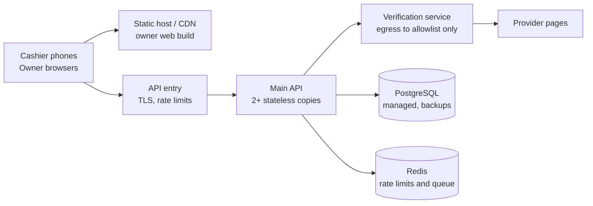

# 08 · Production Readiness

What "production ready" means for PayProof POS, beyond working code. A system that handles other people's money must be safe to run, safe to change, and safe to recover.

| | |
|---|---|
| **Version** | 0.1 draft |
| **Related** | [SECURITY.md](../SECURITY.md) · [TRD](02-technical-requirements.md) · [Implementation plan](06-implementation-plan.md) · [EVALS](agent/EVALS.md) |

---

## 1. Definition

The product is production ready when all of these are true:

1. Every **Must** requirement in the PRD works and has tests.
2. The security rules in [SECURITY.md](../SECURITY.md) pass their tests, including row level security, rate limits, and error-leak checks.
3. The verification evaluation has been run on the held-out set, and the real numbers are written down.
4. The system can be deployed from scratch by one command sequence, and rolled back.
5. A backup has been **restored** successfully at least once.
6. Someone is notified when it breaks, and there is a written plan for what to do.
7. Real shop owners and cashiers have used it in a trial, and their problems are fixed or listed.

## 2. Environments

| Environment | Purpose | Data |
|---|---|---|
| **Local** | Daily development with Docker Compose and the mock provider | Synthetic only |
| **Test (CI)** | Automated tests on every pull request, fresh database each run | Synthetic only |
| **Staging** | A copy of production for release checks and demos | Synthetic, or consented trial data kept apart |
| **Production** | Real shops | Real |

Rules: no production data in any other environment, no shared secrets between environments, staging and production differ only by configuration.

## 3. Deployment architecture (target)

| Concern | Decision |
|---|---|
| Web dashboard | Static build on a CDN or static host. No server runtime |
| API and verification service | Containers, stateless, at least two copies of the API, health checks, rolling deploys |
| Database | Managed PostgreSQL with automated backups and point-in-time recovery if the provider offers it. Separate roles for migrator and API |
| Redis | Rate limits and queue. If it is down, rate limiting fails safe for sensitive routes and the queue falls back to PostgreSQL |
| Network | The verification service can reach only the provider allowlist. The API reaches the database and Redis. Nothing else is exposed |
| Region | Choose a region close to the users. Check data protection and residency expectations with the advisor before storing real data |
| Mobile apps | Signed Android builds. Updates are tested on two phone models. A minimum supported version can be enforced by the API |

## 4. CI/CD

Every pull request must pass:

| Gate | Tool or check |
|---|---|
| Format, lint, type check | ESLint, Prettier, `tsc`, `ruff`, `mypy` |
| Unit and integration tests | Vitest, pytest, API tests on real PostgreSQL |
| RLS and authorization tests | Cross-business, cross-branch, fail-closed |
| Rate-limit tests | Per route class |
| Error-leak test | Forced failures reveal nothing internal |
| Secret scan | gitleaks on the diff and history |
| Build inspection | Scan the web bundle and APK for secrets and private URLs |
| Dependency audit | Lockfile audit, license check |
| Evals | Safe-fetch, parsing, receiver, decision, and concurrency suites, with a regression limit |
| Migration check | Apply on a fresh database and on a seeded one |

Release flow: merge to main, build once, deploy to staging, run smoke tests and the release check, then promote the **same build** to production. Migrations use expand and contract so a rollback is possible.

## 5. Configuration and secrets

- All configuration through environment variables, with a validated schema that refuses to start when something is missing or malformed.
- Secrets in a secrets manager. Rotation documented for the database, tokens, and the account encryption key.
- Provider host allowlist is data, changed through a reviewed migration or an owner-approved admin action, and audit-logged.
- The apps contain only the public API address and version. See SECURITY.md section 3.

## 6. Observability

| Area | What |
|---|---|
| Logs | Structured JSON, request ID on every line, no personal data or secrets |
| Metrics | Request rate, error rate, latency percentiles per route, verification verdict counts, provider fetch latency and failure rate, queue depth, rate-limit hits, sync failures |
| Traces | Request ID carried from the app through the API to the verification service |
| Alerts | Error rate spike, verification failures spike, provider unreachable, queue backlog, database connections near the limit, backup failure, certificate expiry, repeated failed sign-ins |
| Health | `/health` for liveness and a deeper readiness check per service |
| Client errors | Crash and error reports from the apps, scrubbed of personal data, carrying the same reference code shown to the user |

## 7. Service levels (starting targets)

| Measure | Target |
|---|---|
| API availability | 99.5% monthly while in trial, raised later |
| Cash sales | Work with no connection at all |
| Verification, QR scan to verdict | p95 under 5 seconds when the provider responds |
| Dashboard summary | Under 1.5 seconds for a month and three branches |
| Recovery from a failed deploy | Under 15 minutes by rollback |
| Data loss on database failure | At most 5 minutes if point-in-time recovery is available, otherwise at most 24 hours |

These are targets to measure against, not promises. Record real numbers.

## 8. Backups and recovery

- Automated daily database backups, encrypted, kept for at least 14 days.
- **Restore test** on a schedule and before launch, into a clean environment. A backup that has not been restored is not a backup.
- Written recovery steps: database restore, secrets rotation, redeploy from the last good build.
- Receipt images and page copies follow the retention period and are deleted on schedule.

## 9. Performance and load

| Test | Pass condition |
|---|---|
| Scan to cart on a mid-range Android phone | Under 300 ms |
| 3 branches, 10 cashiers, peak rate of sales plus verifications | Targets in the TRD are met |
| Seed 50,000 sales, run the dashboard queries | Under 1.5 s |
| Provider slow or down | Cash sales unaffected, mobile-money sales Waiting, no queue explosion |
| 100 simultaneous claims of one transaction ID | Exactly one succeeds |
| Rate-limit abuse from one device | Limited without affecting others |
| Compressed payload sizes | Recorded and compared with the budget |

## 10. Privacy, legal, and provider terms

- Check the applicable personal data protection law and what it requires for collecting, storing, and deleting data. Ask the advisor.
- Check each provider's terms for automated access to receipt pages (Assumption A4). Record the answer in MEMORY.md.
- Publish a short plain-language privacy notice for owners and cashiers: what is collected, why, how long it is kept, how to delete it.
- Terms for owners: who is responsible for cashier accounts and for the saved payment accounts they enter.
- Never claim the system guarantees fraud prevention. State the limitations in SECURITY.md section 20 and GUARDRAILS section 9.

## 11. Support and operations

| Item | Plan |
|---|---|
| Who gets alerts | Named people, with a backup |
| Reference codes | Every user-facing error shows a short code that maps to a log entry |
| Runbooks | One page each: provider pages unreachable, database down, verification errors spike, a cashier phone lost, an owner locked out, suspected account misuse, rotating a leaked secret |
| Owner support | A simple way to report a problem, with the reference code |
| Release notes | Plain language, one paragraph per release |
| Changes to saved payment accounts | Always alert the owner |

## 12. Trial before launch

1. Staging demo with synthetic data to the advisor.
2. One friendly shop, one branch, a few days, with the owner watching and a team member present.
3. Compare the system's verdicts with the owner's own judgement of each payment. Record every disagreement.
4. Fix, repeat, then widen to more cashiers or a second branch.
5. Write the results into the evaluation report.

## 13. Production checklist

- [ ] All Must requirements demonstrated
- [ ] Security tests green: RLS, authorization, rate limits, error leaks, secrets, hostile links
- [ ] Held-out evaluation run and recorded
- [ ] One-command deploy and a tested rollback
- [ ] Backup restored successfully
- [ ] Alerts configured and tested by causing a failure
- [ ] Runbooks written
- [ ] Privacy notice and terms ready
- [ ] Provider terms checked
- [ ] Trial completed with results written down
- [ ] Known limitations listed for owners and in the thesis
